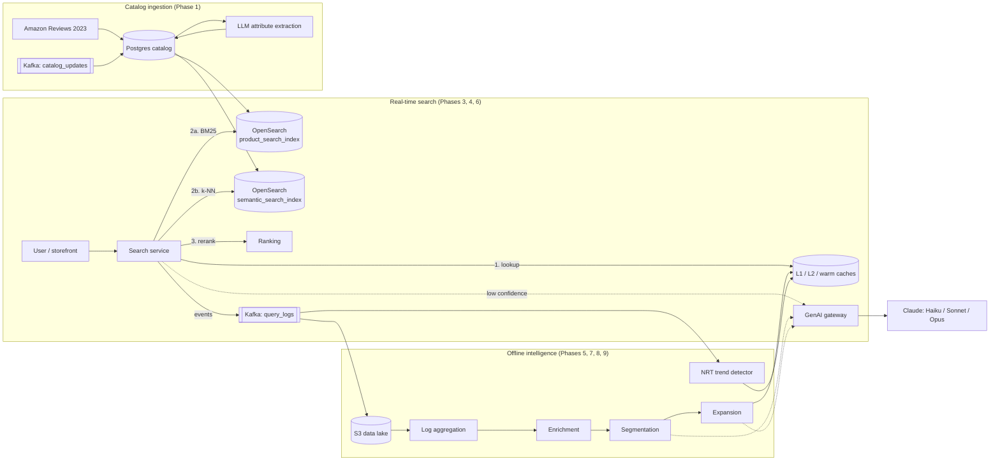

# Intelligent Search — AI-Powered E-Commerce Search (Case Study MVP)

A working, end-to-end implementation of the system designed in **"Case Study: AI-Powered Search for E-Commerce
Platforms"** (Chapter 5, `~/Desktop/Project 4.pdf`): LLM query understanding, hybrid keyword + semantic retrieval,
complementary-product discovery, personalization, tiered caching, and an offline LLM pipeline that keeps the
online path fast.

It is a **portfolio / learning MVP**: every flow in the case study is implemented, at small scale (10k products),
on local open-source infrastructure, with the same component boundaries and data contracts as the design so each
piece could be swapped for its production counterpart.

> **Use this README to follow the project.** [Progress tracker](#progress-tracker) shows where we are;
> [Decision log](#decision-log) and [Spend log](#spend-log) record what changed and what it cost.

---

## Contents

1. [Progress tracker](#progress-tracker)
2. [What the case study asks for](#what-the-case-study-asks-for)
3. [Architecture](#architecture)
4. [Cost policy: tiered execution](#cost-policy-tiered-execution)
5. [Quickstart](#quickstart)
6. [Repository layout](#repository-layout)
7. [Phase 0: Foundations](#phase-0-foundations-done)
8. [Phase 1: Data and catalog ingestion](#phase-1-data-and-catalog-ingestion-done)
9. [Phase 2: GenAI gateway](#phase-2-genai-gateway-done)
10. [Phase 3: Online search fast path](#phase-3-online-search-fast-path-done)
11. [Phase 4: Fallback path](#phase-4-fallback-path-done)
12. [Phase 5: Offline query pipeline](#phase-5-offline-query-pipeline-done)
13. [Phase 6: Cache tiers](#phase-6-cache-tiers-done)
14. [Phase 7: Product discovery](#phase-7-product-discovery-done)
15. [Phase 8: Ranking](#phase-8-ranking-done)
16. [Phase 9: Near-real-time trends](#phase-9-near-real-time-trends-done)
17. [Remaining phases (roadmap)](#remaining-phases-roadmap)
18. [Spend log](#spend-log)
19. [Decision log](#decision-log)
20. [Problems hit and how they were fixed](#problems-hit-and-how-they-were-fixed)
21. [Testing](#testing)
22. [Make targets](#make-targets)

---

## Progress tracker

Last updated: **2026-10-15** (after Phase 6)

| Phase | What it delivers | Status |
|---|---|---|
| 0. Foundations | Docker stack, shared schemas, normalization, DB schema, indices, topics, buckets | ✅ Done |
| 1. Data & catalog ingestion | 10k-product catalog, taxonomy, LLM attribute enrichment, keyword + vector indices, freshness path, synthetic users & logs | ✅ Done |
| 2. GenAI gateway | Task→model routing, circuit breakers, time budgets, guardrails, cost metrics, embedding service | ✅ Done |
| 3. Online search: fast path | `GET /v1/search`, parallel BM25 + k-NN, fusion, confidence score, negation handling, event logging | ✅ Done |
| 4. Fallback path | LLM rewrite on low confidence, retry, degrade gracefully | ✅ Done |
| 5. Offline query pipeline | Log aggregation → enrichment → segmentation → expansion → cached ES queries | ✅ Done |
| 6. Cache tiers | L1 in-process, L2 Redis, warm semantic tier, hot-list warming, invalidation | ✅ Done |
| 7. Product discovery | Co-purchase mining + LLM complement selection → "Pairs well with" | ✅ Done |
| 8. Ranking | Offline static ranking + LightGBM personalized re-rank | ✅ Done |
| 9. Near-real-time trends | Sliding-window trend detection + lite enrichment | ✅ Done |
| 10. Observability | Prometheus metrics, Grafana dashboards, alert rules | ⬜ Next |
| 11. Testing & evaluation | Golden set, offline metrics, LLM-as-judge, load test | ⬜ |
| 12. Frontend demo | Next.js storefront with a "which path served this" debug panel | ⬜ |

**Milestones:** M1 = Phases 0–3 (hybrid search working) · M2 = 4, 8-baseline, 12 (first demo) · M3 = 5–7 ·
M4 = 8-ML, 9 · M5 = 10–11.

**Where we are now:** Phases 0–9 are complete and verified against live infrastructure. Search now checks the
cache tiers first: hot queries come back from the results cache in **~6 ms**, cached hard queries (L1 / L2 / warm)
in **15–80 ms** without touching the fast path, and a low-confidence query similar to a cached one is answered
from the warm tier in ~200 ms instead of a 2–4 s LLM call. Results now carry **"Pairs well with"**
complements mined from co-purchases (163 categories, +3.6 ms), and hot queries carry related searches. **Milestone
M3 (Phases 5–7) is reached.** Results are now re-ranked by a LightGBM LambdaMART model (NDCG@10 0.557 → 0.766
on held-out searches, < 2.5 ms per request), and a near-real-time detector caches trending hard queries within
seconds, off the request path. **Milestone M4 (Phases 8–9) is reached.** Next is Phase 10, observability.

---

## What the case study asks for

**Functional requirements**
- *Natural language understanding*: long-tail queries such as "healthy snacks without nuts for kids".
- *Semantic search*: relevant results with or without an exact keyword match.
- *Product recommendations*: complementary items ("cheeseburst pizza" → Coke/Pepsi; "brownie" → ice cream).
- *Personalization*: results shaped by each user's history and preferences.

**Non-functional requirements**: relevance, P90 < 1 s and P99 < 5 s, availability when an LLM provider
fails, LLM cost control, and near-real-time catalog freshness (price, stock).

**Design in three flows**
1. **Offline query processing**: mine past queries, have an LLM segment and expand them, and cache the resulting
   search queries.
2. **Real-time search**: cache lookup → fast hybrid search → LLM rewrite only when confidence is low.
3. **Product discovery**: co-purchase data + an LLM choose "pairs well with" items offline; served from cache.

---

## Architecture



**Case study component → what this MVP uses**

| Case study | MVP |
|---|---|
| Elasticsearch `product_search_index` | OpenSearch 2.15 (same mapping: BM25 text fields, keyword filters, nested attributes) |
| Vector DB `semantic_search_index` (HNSW) | OpenSearch k-NN index, HNSW (lucene engine, cosine) |
| DynamoDB (`product_catalog`, `user_profile`, `smart_query_cache`) | Postgres 16 (JSONB for attributes/preferences) |
| Redis L2 / discovery cache | Redis 7.2 |
| In-JVM L1 cache | In-process cache in the search service (Phase 6) |
| Warm semantic cache | OpenSearch k-NN index `warm_query_cache` |
| Kafka | Redpanda (Kafka-compatible) |
| Spark / Flink | Python batch jobs (Polars) / Python stream consumer |
| S3 (data lake, hot list) | SeaweedFS S3 API |
| OpenAI Ada embeddings (1536-d) | Local `BAAI/bge-small-en-v1.5` (384-d) |
| GenAI service / LLM gateway | FastAPI gateway (`services/genai_gateway`) |
| LLM providers | Claude, tiered by task (see cost policy) |
| Kubernetes, multi-AZ | Out of scope for the MVP (single-host Docker Compose) |

---

## Cost policy: tiered execution

Cost is a primary design criterion. **Every task runs at the cheapest tier that meets its quality bar**: plain
code when the output is deterministic, a cheap model for simple language tasks, and stronger models only for
genuinely complex work, ideally as an *escalation* after a cheap attempt fails a code check.

| Tier | Engine | Used for |
|---|---|---|
| **0: Code** (free) | Python / SQL / OpenSearch, local embeddings, LightGBM | query normalization + spell correction (SymSpell over catalog vocabulary), cache keys and all cache tiers, log aggregation and query frequency, profile/context lookups, **compiling search queries (template, not LLM)**, taxonomy match by exact/alias/embedding, co-purchase mining, static ranking, personalized re-rank, confidence score, trend detection, related searches from logs, attributes already present in structured product data, embeddings |
| **1: Cheap**: `claude-haiku-5-5`, effort `low` | Batch API offline; direct calls online | catalog attribute extraction, offline query segmentation, NRT lite segmentation, online fallback rewrite, choosing complements from a supplied list |
| **2: Strong**: `claude-sonnet-5-5` | Batch API; escalation only | query expansion for head queries (top 20%, cached and reused), and retries when a Tier 1 answer fails validation |
| **3: Frontier**: `claude-opus-5-5` | low-volume offline | LLM-as-judge evaluation (≤ 500 sampled queries per run) |

Rules:
- **Cascade, not default-high.** Tier 1 answers first, code validates (schema, taxonomy membership, non-empty
  results), and only failures go to Tier 2. If a task escalates more than ~15% of the time, re-evaluate its tier.
- **Long-tail queries never get Tier 2 offline**: the warm semantic cache or the Tier 1 fallback serves them.
- **Batch API for all offline LLM work** (50% cheaper), with inputs de-duplicated first and outputs cached.
- **Small prompts by design**: LLM tasks get ~20 candidate taxonomy paths pre-selected by local embeddings, not the
  whole 1,411-node taxonomy.
- **Pilot before any paid bulk run** (≤ 200 items) and report the measured cost.
- `services/genai_gateway/src/genai_gateway/routing.yaml` is the **single source of truth** for task → model chain,
  effort and timeout. The gateway exports per-task token and cost metrics so these choices can be revisited with data.

**Where the MVP deliberately departs from the case study to save cost:** the doc uses an LLM for spell
correction, writing the Elasticsearch query JSON, taxonomy classification, and related searches. Here those are
code (Tier 0); the LLM only makes the judgement calls (which alternatives fit the intent, which category among
candidates).

---

## Quickstart

**Prerequisites:** Docker Desktop (8 GB memory recommended), [uv](https://docs.astral.sh/uv/), an Anthropic API key;
on macOS, `brew install libomp` for LightGBM (Phase 8; without it search falls back to the linear ranker).

```bash
cp .env.example .env              # then set ANTHROPIC_API_KEY
make install                      # Python 3.12 venv + dependencies (uv)
make up                           # start OpenSearch, Redis, Postgres, Redpanda, SeaweedFS, Prometheus, Grafana
make migrate                      # Postgres schema
make bootstrap                    # Kafka topics, S3 buckets, OpenSearch indices (idempotent)

# Phase 1: build the catalog (10k products by default; SCALE=1.0 for 50k)
make ingest                       # download sample -> load Postgres -> index (keyword + vectors)
make enrich-submit LIMIT=200      # paid: pilot LLM enrichment first, check cost with enrich-collect
make enrich-submit                # paid: the rest (Haiku via Batch API, ~$0.07 per 1k products)
make enrich-status                # poll; batches usually finish within the hour
make enrich-collect               # merge results into the catalog, prints measured cost
make index                        # re-index with enriched attributes and tags
make synth                        # synthetic users + search logs -> S3 data lake, user profiles, Kafka

# Phase 2: GenAI gateway
make gateway                      # http://localhost:8001  (docs at /docs, metrics at /metrics)

# Phase 3: search service
make search                       # http://localhost:8000/v1/search?q=beef%20jerky&debug=true
make test                         # unit tests (no network, no API calls)
```

Service ports: OpenSearch `9200` · Redis `6379` · Postgres `5432` · Redpanda `9092` · S3 `8333` ·
Prometheus `9090` · Grafana `3001` · gateway `8001` · search service `8000`.

---

## Repository layout

```
intelligent-search/
├── docker-compose.yml            # local infrastructure (7 services, health-checked)
├── Makefile                      # all common commands
├── pyproject.toml                # one uv project; packages listed under [tool.hatch...]
├── alembic.ini, migrations/      # Postgres schema (0001 initial, 0002 LLM enrichment fields)
├── libs/common/src/common/       # shared library
│   ├── config.py                 #   settings from .env
│   ├── schemas.py                #   payload contracts from the case study (search API, pipeline payloads)
│   ├── normalize.py              #   query normalization, cache-key hash, spell corrector
│   ├── indices.py                #   OpenSearch mappings + "semantic document" builder
│   ├── embeddings.py             #   local bge-small embeddings
│   ├── embedding_service.py      #   embeddings + Redis cache (shared by gateway and search)
│   ├── topics.py, db.py, llm.py  #   topic/index names, Postgres connection, Anthropic client
│   └── bootstrap.py              #   create topics, buckets, indices
├── services/genai_gateway/src/genai_gateway/
│   ├── routing.yaml              #   task -> model chain (cost policy lives here)
│   ├── prompts/*.v1.j2           #   versioned prompt templates
│   ├── tasks.py, schemas.py      #   task registry, I/O models, code-side guardrails
│   ├── core.py                   #   routing, failover, breakers, budgets, cost; Batch API helpers
│   ├── breaker.py, llm.py        #   circuit breaker; provider adapter
│   ├── embed.py                  #   embedding service with Redis cache
│   └── app.py                    #   FastAPI app
├── services/search_service/src/search_service/
│   ├── app.py                    #   FastAPI: /v1/search, /v1/events
│   ├── engine.py                 #   fast-path orchestration
│   ├── retrieval.py              #   BM25, k-NN, hydration (async OpenSearch)
│   ├── fusion.py                 #   reciprocal rank fusion + confidence score
│   ├── filters.py                #   `filters` param -> OpenSearch clauses
│   ├── negation.py               #   "without nuts" / "not too formal" handling
│   ├── fallback.py               #   LLM rewrite path: memo, retry search, interleave, write-back
│   ├── gateway_client.py         #   HTTP client for the GenAI gateway
│   ├── taxonomy.py               #   embedding-preselected candidate categories
│   ├── events.py                 #   analytic events to Kafka, click attribution
│   └── vocab.py                  #   spell-correction dictionary from the catalog
├── pipelines/
│   ├── ingestion/                # download, load_catalog, resize_catalog, enrich_llm, index, catalog_updates
│   └── synthetic/generate.py     # synthetic users, sessions, search events, co-purchases
├── tests/                        # unit tests
├── ops/prometheus/               # scrape config (dashboards/alerts in Phase 10)
└── data/                         # git-ignored: raw sample, batch state, local copy of the lake
```

---

## Phase 0: Foundations (done)

- **Infrastructure** (`docker-compose.yml`): OpenSearch (security plugin off for local use), Redis, Postgres,
  Redpanda, SeaweedFS (S3), Prometheus, Grafana, all with health checks so `make up` waits until ready.
- **Shared contracts** (`common/schemas.py`): the `/v1/search` request/response (camelCase JSON, exactly the shape on
  p.144 of the case study, plus a `pairsWellWith` section and a `debug` block that shows which path served a query),
  and every pipeline payload: enriched query, segmented query, analytic event, cached query (with
  `source` + `version`, so batch results always overwrite near-real-time results, as the doc requires).
- **Query normalization** (`common/normalize.py`): Unicode normalization, lowercasing, punctuation stripping, and
  spell correction against the catalog's own vocabulary (Tier 0, not an LLM).
- **Database** (`migrations/`): `product_catalog` (with the doc's category+price secondary index), `taxonomy`,
  `user_profile`, `smart_query_cache` (persistent tier), `co_purchase`.
- **Search indices** (`common/indices.py`): `product_search_index` (doc p.163 mapping), `semantic_search_index`
  (HNSW vectors), `warm_query_cache` (semantic cache for long-tail queries).
- **Kafka topics**: `query_logs`, `log_processing_queue`, `query_process_queue`, `segmented_queries_queue`,
  `list_update`, `catalog_updates`. **S3 buckets**: `datalake`, `hotlist`.

---

## Phase 1: Data and catalog ingestion (done)

Implements the case study's ingestion and enrichment pipeline (Fig 5.1): *LLM extracts structured tags → index for
keyword search → index for semantic search*.

**1. Dataset** (`pipelines/ingestion/download.py`). Product metadata from
[McAuley-Lab/Amazon-Reviews-2023](https://huggingface.co/datasets/McAuley-Lab/Amazon-Reviews-2023), streamed (the
source files are 1–18 GB) from four categories so the case study's example queries have matching products:

| Category | Products |
|---|---|
| Grocery & Gourmet Food | 3,000 |
| Clothing, Shoes & Jewelry | 3,000 |
| Electronics | 2,000 |
| Home & Kitchen | 2,000 |
| **Total** | **10,000** |

Only products with a price, a title and a category path at least three levels deep are kept (about half the source
rows have no price). Prices are in USD. `bought_together` is empty in the source, so co-purchases are synthetic.

**2. Catalog + taxonomy** (`load_catalog.py`, `resize_catalog.py`). Products load into Postgres; a 4-level
taxonomy (1,411 nodes, e.g. `Clothing, Shoes & Jewelry > Women > Shoes > Slippers`) is built from category paths.
Only descriptive fields from the raw `details` become attributes (color, material, flavor, …), not UPCs or
dimensions. Stock is synthetic (~5% out of stock). We first sampled 50k and then reduced to a stratified 10k to
manage cost; `resize_catalog.py` keeps already-enriched products so paid work isn't thrown away.

**3. LLM attribute enrichment** (`enrich_llm.py`, Tier 1). The Message Batches API sends 20 products per request to
`claude-haiku-5-5` with a strict JSON schema whose attribute keys are an enum (a guardrail: the model cannot invent
keys). Per product it returns a normalized `product_type` ("tube socks"), attributes (`gender: men`), and shopper
`search_tags` ("soft sole", "gift for elderly", "post-workout snack"). Catalog-sourced values win over LLM values
on conflict. Product ids the model invents are ignored. Commands: `submit` / `status` / `collect` / `cancel`.
**Result: 10,000 / 10,000 products enriched.**

**4. Indexing** (`index.py`). Each product goes to `product_search_index` (BM25 fields, filters, nested attributes,
flattened tags, a popularity prior `static_score`) and to `semantic_search_index` as a 384-d embedding of its
"semantic document" (doc p.164 format: *"Men's Terra Running Shoe by Olympus Athletics. Category: …"*).

**5. Freshness path** (`catalog_updates.py`). A consumer on `catalog_updates` applies price/stock changes to
Postgres and both indices within seconds. *Verified live:* one message changed product `B01DPV07ZI` (basmati rice)
from $14.94 in stock to $9.99 out of stock in Postgres, the keyword index and the vector index; it was then
restored. Try it:
`uv run python -m pipelines.ingestion.catalog_updates emit <product_id> --price 9.99 --in-stock false`.

**6. Synthetic users and behavior** (`pipelines/synthetic/generate.py`). 5,000 users with category and brand
affinities, devices and cities. Sessions issue queries derived from the products they intend to buy (head queries
like "beef jerky", long-tail like "gift for elderly", ~4% typos), with a click → cart → purchase funnel and
complementary follow-up purchases (pizza → soda, brownie mix → ice cream, coffee → creamer, shoes → socks, …).

| Output | Value |
|---|---|
| Search events | 74,682 over 14 days |
| Clicks / purchases | 48,570 / 11,092 |
| Unique queries | 28,688 (top 20% of queries carry 63% of traffic) |
| Where | S3 `datalake/search_events/dt=YYYY-MM-DD/part-0.parquet` (15 partitions), `user_profile` table, latest 2,000 events on `query_logs` |

---

## Phase 2: GenAI gateway (done)

The case study's "GenAI service / LLM gateway" (p.157–158): one internal API for every LLM interaction,
hiding providers from the rest of the system.

**API** (`make gateway`, port 8001)

| Endpoint | Purpose |
|---|---|
| `POST /v1/llm/{task}` `{"inputs": {...}}` | run a task; returns output, model used, validity, every attempt, tokens, cost, latency |
| `POST /v1/embed` `{"texts": [...], "kind": "query"\|"document"}` | local embeddings with a Redis cache |
| `GET /v1/routing` | the task → model routing table |
| `GET /v1/breakers` | circuit breaker state per model |
| `GET /metrics`, `GET /healthz` | Prometheus metrics, liveness |

**Tasks**: `segment`, `expand_head`, `expand_tail`, `rewrite`, `nrt_segment`, `discover`, `judge`; plus
`extract_attributes` (batch-only, used by ingestion).

**How a call works** (`core.py`)
1. Validate inputs against the task's Pydantic model; render the versioned system prompt; serialize inputs with
   sorted keys (identical inputs → identical prompt bytes → cacheable).
2. Walk the task's model chain from `routing.yaml`. Skip a model whose **circuit breaker** is open (5 transient
   failures → open for 30 s → one half-open trial).
3. Call with the **remaining time budget** for the whole chain (no SDK retries, which would overrun it).
4. Move to the next model on: transient error (timeout, connection, 429, 5xx), refusal, truncated output, invalid
   JSON, or, when the route allows escalation, output that fails the task's **guardrail**.
5. Return the result with `valid`, `escalated`, per-attempt outcomes, tokens and cost; 503 if every model failed.

**Guardrails** (code, `tasks.py`): taxonomy paths must come from the supplied candidates; expansion may only pick
product types that were retrieved from the catalog; discovery may only pick items from the co-purchase list; the
judge's winner is recomputed from its scores. Invented values are dropped, never passed downstream.

**Offline use**: `build_batch_request()`, `parse_and_validate()` and `next_model()` let pipelines submit through
the Batch API with the same prompts, schemas, routing and guardrails, then escalate failures in a follow-up batch.

**Metrics**: `gateway_llm_attempts_total{task,model,outcome}`, `gateway_llm_tokens_total`,
`gateway_llm_cost_usd_total`, `gateway_llm_latency_seconds`, `gateway_escalations_total`, `gateway_breaker_state`,
`embedding_cache_total`.

**Live verification (2026-10-14, all on Haiku):**

| Task | Query | Result | Latency | Cost |
|---|---|---|---|---|
| rewrite | "stuff for my dorm party" | snack + soft-drink categories; keywords chips, soda, party cups | 1.5–2.1 s | $0.00007–0.0002 |
| segment | "organic aged basmati rice" | category rice, quality basmati, taxonomy `…> Dried Grains & Rice` | 3.4 s | $0.0002 |
| nrt_segment | "old people home footwear" | product_type footwear | 1.2 s | $0.00005 |
| discover | "brownie" + co-purchase list | vanilla ice cream, chocolate sauce, whipped cream (+ eggs, chips) | 3.3 s | $0.00007 |
| embed | "winter wear for women" twice | 2nd request served from Redis cache | n/a | free |

*Quality note:* for "brownie" Haiku also kept basket filler (eggs, chocolate chips) that the prompt asks it to
skip. Tracked for the Phase 11 evaluation before deciding whether `discover` needs a different prompt or tier.

Try it:

```bash
curl -s localhost:8001/v1/llm/rewrite -H 'content-type: application/json' \
  -d '{"inputs":{"query":"stuff for my dorm party","candidate_categories":[
       "Grocery & Gourmet Food > Snacks & Sweets > Snack Foods",
       "Grocery & Gourmet Food > Beverages > Soft Drinks"]}}' | jq
```

---

## Phase 3: Online search fast path (done)

The case study's real-time search flow (p.156–157, Fig 5.7), minus caches (Phase 6) and fallback (Phase 4).
**Entirely Tier 0: no LLM calls, no API cost.**

**API** (`make search`, port 8000), exactly the contract on p.143–145 of the case study:

```
GET /v1/search?q=hill+station+outfits&userId=u00001&sessionId=s1&page=1&pageSize=20
               &filters={"brand":"Decathlon","size":"S"}&sortBy=relevance|price_asc|price_desc&debug=true
POST /v1/events  {"searchId": "...", "type": "click"|"add_to_cart"|"purchase", "productId": "..."}
```

The response has the doc's shape (`searchId`, `correctedQuery`, `results[]` with `productId/title/description/
imageUrl/price{amount,currency}/brand/rating`, `relatedSearches`, `pagination`), plus `pairsWellWith` (Phase 7)
and, with `debug=true`, `debug{servedBy, confidence, latencyMs}` for the demo UI.

**How a search runs** (`engine.py`)
1. **Normalize + spell-correct** (code). The dictionary is general English (82k words, bundled with SymSpell) plus
   catalog vocabulary. English stops ordinary words ("dorm") from being "corrected" into product terms; among
   equally close suggestions a catalog word wins ("jekry" → "jerky", not "jerry").
2. **Negation** (code, `negation.py`): "without nuts", "no sugar", "not too formal" are removed from what retrieval
   sees, and results naming the negated thing are dropped ("Raw Walnuts", "Peanut Butter …"), unless the product
   says it is free of it ("Nut-Free Granola"). "Gluten free pasta" keeps "gluten free" in the query.
3. **Retrieve in parallel**: BM25 over name, product type, tags, brand, category and description (field-boosted;
   short queries need every term, longer ones 75%) **while** the query is embedded (Redis-cached), then k-NN top 100
   with brand/price/stock filters applied inside the HNSW search.
4. **Hydrate with all filters**: candidates are fetched from the product index with every filter, which is
   where category and attribute filters reach the vector hits. Out-of-stock items are hidden unless
   `{"in_stock": false}`.
5. **Fuse** with reciprocal rank fusion (BM25 scores and cosines aren't comparable; ranks are). The popularity
   prior only breaks ties (moves a product at most one place near the top); real re-ranking is Phase 8.
6. **Confidence** in [0, 1] = 0.6 × semantic strength (top-3 cosine, rescaled 0.55 → 0.80) + 0.25 × agreement
   between the keyword and vector top 10 + 0.15 × keyword coverage. **Below 0.6 (doc Fig 5.14) the query is
   flagged** for the Phase 4 fallback.
7. **Sort / paginate**: price sorts only consider plausibly relevant results, so a cheap unrelated item can't win.
8. **Log**: a `search` event goes to Kafka `query_logs` in the background (search never waits for analytics);
   the search context is kept in Redis for an hour so `/v1/events` can attribute clicks, carts and purchases.

**Filters** (`filters.py`): `brand` (string or list), `category` (taxonomy prefix), `price_min`, `price_max`,
`in_stock`; **any other key is an attribute filter** (`{"color":"navy","gender":"men"}`), matched on the nested
attributes, so new attribute filters need no code.

**Live evaluation (2026-10-14, 10k catalog, warm caches)**

| Query | Confidence | Top results | Verdict |
|---|---|---|---|
| beef jerky | 0.89 | 3 beef jerky products | ✅ |
| usb c cable | 0.88 | USB-C cables | ✅ |
| waterprof hiking boots | 0.88 | corrected to "waterproof"; waterproof hiking boots | ✅ |
| fleece jacket / coffee mug | 0.77 / 0.78 | fleece jackets / coffee mugs | ✅ |
| organic aged basmati rice | 0.73 | both basmati rices, then organic long-grain rice | ✅ |
| a summer dress that's not too formal | 0.81 | casual summer dresses; the formal dress is gone | ✅ (negation) |
| healthy snacks without nuts for kids | 0.66 | kids' cookies, fruit crisps, snack bars; no walnuts | ✅ (negation) |
| brownie | 0.68 | brownie products | ✅ |
| basmati rice | 0.61 | 2 basmati rices, then a spice (only 2 basmati items in the 10k catalog) | ⚠️ data |
| post-workout food | 0.56 | keto meal replacement, jerky, protein balls | 🔁 fallback |
| old people home footwear | 0.38 | memory-foam house slippers | 🔁 fallback (results already decent) |
| stuff for my dorm party | 0.35 | decor, sprinkles, a rug | 🔁 fallback needed |
| hill station outfits | 0.24 | sweaters, sweatsuit, snow boots | 🔁 fallback needed |
| cheeseburst pizza | 0.22 | cheese snacks, frozen pizza, cheddar | 🔁 fallback needed |
| xqzv blorf | 0.12 | noise | 🔁 fallback (should return "no results") |

The confidence score separates what the fast path handles (0.61–0.89) from the intent-heavy queries the case study
says need an LLM (0.22–0.56). That split is what Phase 4 acts on.

**Latency** (local, warm): **p50 18 ms, p90 20 ms, max 31 ms**; first query after a pause ~0.4 s; uncached new
queries ~35–45 ms. Target is P90 < 1 s.

**Also verified live:** price filter + ascending sort, category / brand / attribute filters, pagination without
overlap, 422 on malformed input, click attribution (202) and unknown search ids (404), search + click events on
Kafka with matching `search_id`, and a stock-out removing a product from results within ~1 s (and restoring it).

## Phase 4: Fallback path (done)

The case study's fallback path (p.157, Fig 5.14): when the fast path can't answer, ask an LLM to rewrite the
query into terms the catalog understands and search again. The doc accepts a slower answer here (P99 < 3–5 s)
because a slow good result beats a fast dead end.

**When it runs:** fast-path confidence < 0.6 or zero results. Everything else never touches an LLM.

**How it runs** (`fallback.py`)

| Step | Tier | What happens |
|---|---|---|
| 1. Memo lookup | 0 | Redis `rewrite:v1:{query hash}`. A hit skips the LLM entirely (7-day TTL). "No usable rewrite" is also memoized (1-day TTL), so nonsense isn't paid for twice. Gateway *failures* are not memoized. |
| 2. Candidate categories | 0 | The 20 taxonomy paths nearest the query embedding (in-memory matrix of 1,400+ path embeddings). |
| 3. Rewrite | **1 (Haiku)** | Gateway `rewrite` task, 4 s budget. Returns keywords, attributes, categories; guardrails drop categories not in the candidates. |
| 4. Compile | 0 | Code builds the query: any keyword must fully match; attributes and categories only **boost** (see decision 18). |
| 5. Retry search | 0 | One BM25 query plus **one k-NN search per keyword**, fused with RRF. |
| 6. Interleave | 0 | Round-robin across keywords, so a multi-intent query shows each need near the top. |
| 7. Choose | 0 | Use the rewrite's results only if their confidence beats the fast path's. Negation exclusions still apply. If the gateway fails, return the fast-path results (HTTP 200, never an error). If fast-path confidence is below 0.15 and there's no usable rewrite, return an honest empty page instead of noise. |
| 8. Write back | 0 | Store the rewrite + compiled query in the warm semantic cache (`warm_query_cache`) and `smart_query_cache` (`source=fallback`), never overwriting a batch-pipeline entry. Phase 6 reads these. |

**Live results (2026-10-14)**

| Query | Fast path | Fallback | Rewrite (Haiku) | Top results now |
|---|---|---|---|---|
| stuff for my dorm party | 0.35 | **0.83** | party cups, chips, soda, string lights, party games | party bundle, chips, peach soda, string lights, … |
| hill station outfits | 0.24 | **0.81** | sweater, jacket, coat, fleece, knit cardigan | turtleneck sweater, fleece jacket, insulated ski jacket |
| old people home footwear | 0.38 | **0.91** | slippers, house shoes, slip-on shoes, indoor shoes | house slippers, fuzzy clog slippers, memory-foam booties |
| post-workout food | 0.56 | **0.87** | protein bar, protein shake, recovery drink, beef jerky, … | jerky protein bars, protein drinks, string cheese |
| cheeseburst pizza | 0.22 | **0.71** | cheeseburst pizza, cheese stuffed crust pizza, frozen pizza, … | frozen pizzas, four-cheese crust pizza, pizza crusts |
| something warm for my grandma | 0.53 | **0.86** | throw blanket, electric blanket, fleece blanket, lap blanket | fleece throw blankets |
| xqzv blorf | 0.12 | no usable rewrite | n/a | **no results** (honest empty page) |
| beef jerky, organic aged basmati rice, … | 0.66–0.89 | not called | n/a | unchanged (fast path) |

The doc's "cheeseburst pizza → Coke/Pepsi" pairing is a *discovery* feature ("Pairs well with"), built in Phase 7.

**Latency:** first-time fallback **2.0–4.2 s** (dominated by the Haiku call; within the doc's 3–5 s P99 budget);
memoized fallback **84–265 ms**; fast path unchanged (~20 ms warm).

**Cost:** ≈ **$0.0001–0.0002 per first-time rewrite**, then free for 7 days via the memo. All Phase 4 testing
spent ≈ $0.0015. A re-run of the whole evaluation spent $0.00 (7/7 memo hits).

**Resilience, verified live:** with the gateway stopped, new low-confidence queries return the fast-path results
with HTTP 200 in 0.09–0.14 s, the failure is not memoized, and the same query uses the fallback once the gateway
is back.

## Phase 5: Offline query pipeline (done)

The case study's offline flow (p.148–155, Figs 5.2–5.6): mine the search logs, work out offline what the hard
queries mean, and cache a ready-to-run search query for each, so the online path rarely needs an LLM.

**Stages** (`pipelines/offline/`, driven by `run.py`; stages talk through the doc's Kafka topics)

| Stage | Tier | What happens |
|---|---|---|
| 1. Aggregate | 0 | Read the S3 data lake (plus live events), sessionize, count query frequency and engagement, assign cache tier by rank (top 5% L1, top 20% L2, rest warm), mine related searches by lift → `query_stats` + `log_processing_queue`. |
| 2. Enrich | 0 | Spell-correct and fold aliases ("beef jekry" → "beef jerky"), add user/context, and run each query through the fast path to get its confidence → `query_process_queue`. |
| 3. Segment | **1 (Haiku)** → 2 | Only queries below the 0.6 confidence gate, seen at least twice, and not processed in the last 7 days. Haiku batch picks category, attributes, brand from ~20 embedding-preselected taxonomy paths; rejected outputs escalate to Sonnet → `segmented_queries_queue`. |
| 4. Link + expand | 0 → **1 (Haiku)** / 2 | Code retrieves the product types that actually exist near the query (k-NN); the LLM picks which fit the intent (Sonnet for L1 head queries, Haiku for the rest). Only this run's segments are expanded. |
| 5. Validate | 0 | Compile to an OpenSearch query (product types required, attributes boost, decision 26) and count in-stock matches; zero means the chosen types don't exist, so escalate to Sonnet. |
| 6. Write | 0 | `smart_query_cache` (`source=batch`, overwrites fallback entries) + warm semantic tier; failures marked so they aren't paid for again within 7 days. |

Runs are scheduled with `make pipeline-schedule` (daily 02:00 UTC; `HOURLY=1` for hourly).

**Full run 20261015T035558 (measured)**

| | Queries | Result | Cost |
|---|---|---|---|
| Segmentation | 3,616 submitted | 3,501 valid from Haiku (96.8%); 115 escalated, Sonnet fixed 54; **3,555 published**; 61 unsegmentable ("beach vacation", "hand wash only", garbled text) | $0.398 |
| Expansion | 3,649 submitted (incl. 99 pilot repeats, bug since fixed) | 3,181 valid first pass; 468 escalated, Sonnet fixed 155; **3,336 cached** | $1.104 |
| **Total** | | **$0.00042 per query** | **$1.50** |

**What the run taught us.** Expansion cost 2.5× the estimate because escalation was mis-aimed. Re-checking
the 465 escalated tail queries against the batch results (free):

| First-pass failure | Escalated | Sonnet fixed | Fixed in code by attribute relaxation |
|---|---|---|---|
| Valid output, zero in-stock results ("cheap vital wheat gluten", "small lite salt") | 371 | 136 (37%) | **371 (100%)**, 102 keeping real attributes ("slotted", "baby") |
| No valid product type (catalog gap: "sarong" → shrimp paste) | 94 | 19 (20%) | n/a, still escalates |

With per-run scoping and attributes that no longer empty a query (decisions 22, 23 → 26), the same run would
have cost **≈ $0.85** instead of $1.50.

## Phase 6: Cache tiers (done)

The case study's caching design (p.170–173): store *compiled queries*, not results, in tiers by query frequency,
so the online path skips both the fast path and the LLM for known queries while prices and stock stay live.

**Lookup order** (`search_service/engine.py`, `cache.py`)

| Step | Tier | Store | Serves |
|---|---|---|---|
| 1. Results cache | 0 | Redis, key = query + filters + sort + hot-list version, 10 min TTL | Hot queries only. Stores ranked ids; the page is re-hydrated, so price is current and stock-outs drop out. |
| 2. L1 | 0 | In-process dict = the hot list (top 5%, 1,435 queries) | Exact match with a cached query |
| 3. L2 | 0 | Redis `qcache:v1:{hash}` (top 20% with a cached query, 417), 2-day TTL | Exact match |
| 4. Warm, exact | 0 | OpenSearch `warm_query_cache` by id | Any batch- or fallback-cached query |
| 5. Fast path | 0 | BM25 ∥ k-NN (Phase 3) | Done if confidence ≥ 0.6 |
| 6. Warm, similar | 0 | k-NN over cached query embeddings, cosine ≥ 0.91 | Low-confidence queries near a cached one; never negated queries |
| 7. LLM fallback | 1 | Gateway rewrite (Phase 4) | Everything else |

A cached query runs with the request's filters added at execution time, so one entry serves every filter combination.
Cached fallback rewrites replay their per-keyword k-NN and interleaving; batch expansions run their compiled
bool query. Any cache error falls through to the next step.

**Warming and invalidation**

- **Hot-list job** (`pipelines/hot_list/build.py`, last step of `make pipeline`, or `make hot-list`): writes
  `s3://hotlist/hot_list.json`, publishes `{bucket, key, version}` on `list_update`, and writes L2.
- **Search instances** load the hot list at startup and reload it on each `list_update` (broadcast, no consumer
  group). The version is part of every results-cache key, so a new list also retires stale results.
- **Price/stock changes**: the `catalog_updates` consumer purges every cached result list containing the product
  (reverse index `results:idx:{product}`). Cached queries need no purge since they run against the live index.
- **Batch overwrites fallback** entries in `smart_query_cache` (doc p.170); `recompile` re-applies the compiler to
  every stored expansion without LLM calls when compile rules change.

**Live results (2026-10-15)**

| Query | Served by | Latency | Notes |
|---|---|---|---|
| shower curtain liner (1st / 2nd) | fast path / **results cache** | 45–280 ms / **6–9 ms** | Hot, confident query |
| conference speakerphone | **L1** | 15 ms | Batch expansion |
| mineral water, wastebasket | **L2** | 21–37 ms | |
| yellow pillow shams | **warm (exact)** | 31 ms | |
| conference speaker phones | **warm (similar)** | 211 ms | Matched "conference speakerphone" at 0.955; fast path was 0.54. Before Phase 6 this went to the LLM (2–4 s) |
| canister vacuum, winter drinks | fast path | 55–65 ms | Confident: warm-similar not consulted (decision 25) |
| price change on a product in a hot result | fast path, then results cache | | Purged by the `catalog_updates` event, re-cached on the next request |
| `make hot-list` while serving | fast path | | Service reloaded L1; old results-cache generation retired |

**Cache quality.** Serving cached queries first exposed the batch expansions' weak spots. As hard requirements,
must-attributes left 38% of cached queries (1,279) with 1–4 products ("old people home footwear": 1 product
because of "elderly"). They now boost instead (decision 26), and **thin results fell to 690** (2,133 cached queries
return 20+). The rest is mostly narrow catalog coverage. A known gap: some expansions chose the wrong product
types, because candidate types come from one k-NN search around the segmented entity. "stuff for my dorm party"
gets party supplies only, where Phase 4's fallback also found chips and soda, and "hill station outfits" gets
two-piece outfits rather than sweaters. Fixing that means improving candidate retrieval and re-expanding (paid).

## Phase 7: Product discovery (done)

The case study's discovery flow (p.159–160, Fig 5.8): mine what customers buy together, let an LLM keep only the
genuine complements, and show them next to the results as **"Pairs well with"** (the response's `pairsWellWith`).

**Offline** (`pipelines/discovery/`, part of `make pipeline`, or `make discovery`)

| Step | Tier | What happens |
|---|---|---|
| 1. Co-purchase mining | 0 | A basket is everything one session bought **or carted**. Pairs are counted between taxonomy categories, kept at support ≥ 2 sessions and lift ≥ 3, top 15 per category → `co_purchase`. Run 2026-10-15: 15,706 baskets → 1,335 pairs for 350 categories. |
| 2. Complement selection | **1 (Haiku, batch)** | `discover` prompt v2: pick at most 5 genuine complements from the category's co-purchase list, best first; **none is a valid answer**. The guardrail drops anything not in the list. Only categories whose list (or the prompt version) changed are resubmitted. |
| 3. Resolve + store | 0 | Each chosen category → its top 2 in-stock products by static score → Redis `discovery_products:{category}`. Every run re-resolves all entries and deletes categories that lost their co-purchase data. |

**Online** (`search_service/discovery.py`): the primary category is the most common one among the top 5 results;
one Redis GET plus one hydrate (stock-checked, ignoring the shopper's brand/category filters, which describe the
primary product), interleaved one product per complement, products already in the results skipped, at most 6.
It fails open: no complements, never an error. **Cost: 3.6 ms p50 / 5.9 ms p90 on a hit, 0.2 ms on a miss.**

**Why categories, not queries** (decision 29): the plan keyed discovery by the segmented query, which would only
cover the 3,555 queries the batch pipeline segmented. Keyed by the results' category, any query landing in one of
the 163 categories with complements gets them, including confident head queries that never touch an LLM.

**Prompt v1 vs v2 on the same 150 categories**

| | v1 ("choose 3–5") | v2 ("at most 5, none is fine") |
|---|---|---|
| Picks per category | 3.5 avg; never fewer than 2 | 1.3 avg; **51 categories get none** |
| Laptops | keyboards & mice, power strips, cables, laptop bags | same four |
| Potholders & oven mitts | curtains, pillow covers, sheet sets, hangers | none |
| Sauces | fresh fruit, nuts, herbal tea, tea samplers | none |
| Cables | antennas, monitor accessories, earbuds, earpads | antennas |

v1 filled its quota from session noise; v2 keeps the real pairings and says nothing otherwise. A few weak picks
remain (over-ear headphones → camera straps) because the synthetic logs are thin: only 5 sessions bought pizza,
so the case study's own "pizza → soda" pairing never reaches the support threshold.

**Live results (2026-10-15)**

| Query | Pairs well with |
|---|---|
| laptop | keyboard stickers, laptop bag, Bluetooth mouse, TSA laptop backpack |
| maxi dress | comfort sandals, chain necklace, non-slip slippers, platform wedges |
| fashion sneakers | slippers, fleece socks |
| usb flash drive, shower curtain liner | none (Haiku found no genuine complement in their co-purchase lists) |

**Related searches** now reach every hot query: the hot list carries `query_stats.related_searches` (session
pairs with lift ≥ 3) for all 1,435 hot queries, not only cached ones, so fast-path answers include them too. On
synthetic logs these are noisy ("laptop" → "lens adapter", "ipad case"), which is why cached queries prefer
their expansion's own suggestions (Phase 5).

**Cost:** $0.034 for all of discovery (two 150-category pilots at $0.0125 and $0.0124, then 200 categories at
$0.0089), about **$0.00008 per category**. Daily runs only pay for categories whose co-purchase list changed.

## Phase 8: Ranking (done)

The case study's ranking design (p.176–178, Fig 5.16): a global offline score per product, then a personalized
re-rank of the top candidates per request. All Tier 0: logs, arithmetic and a small tree model, no LLM.

**Shared features, one definition** (`services/ranking/src/ranking/features.py`), used by training and serving:

| Feature | Meaning |
|---|---|
| `retrieval_rank` | 1 / (1 + position in the candidate list) |
| `semantic_sim` | cosine(query, product), bge-small |
| `static_score` | offline global score: 0.5 × popularity + 0.5 × smoothed engagement rate (purchase 3 > cart 2 > click 1, per impression) |
| `popularity` | rating weighted by review volume |
| `qp_engagement` | smoothed engagement rate of this product for this query |
| `brand_in_query` | the shopper typed the product's brand |
| `user_brand_aff`, `user_cat_aff`, `user_top_aff` | share of the user's past engagement on this brand / leaf category / department |
| `session_brand_clicks` | clicks on this brand earlier in the session (Redis, 30 min) |
| `price_band_gap` | \|log(price / user's median engaged price)\| |
| `user_has_history` | 1 if the user has any engagement |

**Offline** (`pipelines/ranking/`): a **point-in-time replay** walks every logged search in time order, emits a
training group with features computed from history *before* that search, then folds the search's outcome in. A
user's brand affinity therefore never contains the purchase being predicted. The same replay's final state is
published for serving (`make rank-publish`, also the last step of `make pipeline`): `static_score` for 10,000
products in the index (it is also the fast path's fusion prior and discovery's product pick), engagement for
21,711 queries (`qp:v1:*`) and 4,801 user profiles (`ufeat:v1:*`) in Redis.

**Training** (`make rank-train`): LightGBM LambdaMART on 48,571 logged searches with engagement (703k rows), split
by time: train 34,000, validation 4,857 (early stopping, best iteration 129), test 9,714 (the latest 20%).

| Ranker (test, NDCG@10) | All searches | Users with history |
|---|---|---|
| Logged order | 0.557 | 0.557 |
| Static score only | 0.554 | |
| Linear fallback (hand-set weights) | 0.623 | |
| LightGBM without personal features | 0.766 | 0.767 |
| **LightGBM** | **0.766** | **0.767** |

Gain share: semantic_sim 66%, retrieval_rank 15%, qp_engagement 9%, popularity 6%, brand_in_query 2%,
static_score 2%; personal features ≈ 0.

**Why personalization adds nothing here.** The signal exists in the logs but is rare: when a user has engaged a
brand before, a shown product of that brand is engaged 11.9% of the time vs 6.9% otherwise (1.7×), but only
0.65% of shown products carry any brand history, so it can't move NDCG. Category affinity can't discriminate at all:
the generator shows every result from the target's own category. With 5,000 users spread over thousands of
brands, synthetic shoppers rarely meet a brand twice. The features, plumbing and per-session signal all work
live (tests cover each); they need logs with repeat behaviour to earn weight. Live, the same query for an
anonymous user and for a SanDisk buyer returns the same order, as the offline numbers predict.

**Online** (`ranking/serving.py`): the top 100 candidates are re-scored after retrieval, for relevance order
only. Price sorts are the shopper's choice, and the LLM fallback's keyword interleaving is kept (decision 19). One
Redis round trip fetches the user profile, session brands and query engagement. The results cache stores the
shared retrieval order plus similarities, and every hit is re-ranked per user. Click events update the session's
brand counts. If no model file is present, the linear ranker is used; every failure keeps the retrieval order.

**Live (2026-10-15):** re-rank **< 2.5 ms in 11 of 12 requests** (one cold first call); fast path 27–51 ms,
results cache 10.5 ms, L1 7.7 ms with re-ranking included.

**Cost:** $0. No LLM calls.

## Phase 9: Near-real-time trends (done)

The case study's NRT path (p.169–170, Fig 5.10): notice a query trending *now* and cache a usable query for it
within seconds, instead of waiting for the next daily batch.

**How it runs** (`pipelines/nrt_trends/`, `make nrt`, long-running)

| Step | Tier | What happens |
|---|---|---|
| 1. Count | 0 | Consume `query_logs` (search events only), normalize + spell-correct, count per query in a 5-minute window of 10-second buckets (`window.py`). Every 10 s, queries at or above the threshold (doc: 100 / 5 min; `NRT_THRESHOLD`, `make nrt THRESHOLD=5` for a demo) are trending, also published to Redis `nrt:trending`. |
| 2. Already decided? | 0 | Redis `nrt:seen:{hash}`: a query that got a final decision isn't looked at again for 24 h. |
| 3. Already cached? | 0 | Exact L2 / warm entry of **any** source (batch, fallback, nrt) → skip. |
| 4. Fast-path gate | 0 | The same 0.6 confidence gate as the batch pipeline: confident queries (most head queries) never cost an LLM call. |
| 5. Budget | 0 | At most `NRT_MAX_LLM_PER_HOUR` (200) calls; over budget → retry next tick, not remembered. |
| 6. Lite segmentation | **1 (Haiku)** | Gateway `nrt_segment` v2: 1–4 product types + attributes, short prompt, no RAG, ≈ $0.00007 per query. |
| 7. Compile + check | 0 | Same compiler as batch expansions (types required, attributes boost); zero in-stock results → skip. |
| 8. Write | 0 | Warm tier + L2 (`SET NX`) + `smart_query_cache`, `source=nrt`, versioned. Never over a batch or fallback entry; the next batch run overwrites it (doc p.170). |

**Where NRT fits in this system.** The request path's LLM fallback (Phase 4) already caches a hard query on its first
search, so a trending hard query is usually cached before it trends. NRT catches what the request path couldn't:
searches while the gateway was down or slow (fallback failures aren't cached), or with the fallback switched off
(`FALLBACK_ENABLED=false`, e.g. to cap online LLM spend). It does it in the background, off the request path.

**Live demo (2026-10-15)**: search service with the fallback off, detector at threshold 5, 6 searches each:

| Query | Fast path | NRT decision | Next search |
|---|---|---|---|
| beef jerky | 0.888 | **confident**, no LLM | fast path |
| stuff for my dorm party | | **cached** (batch L1), no LLM | L1 |
| cozy movie night essentials | 0.185 | **cached_nrt**: throw blankets, popcorn, candles, pajamas | **L2, 40 ms**: knit and fleece throws, BoomChickaPop popcorn |
| tailgate party must haves | 0.257 | **cached_nrt**: folding chairs, coolers, portable grills, snacks | **L2, 21 ms**: beer can coolers, folding chairs, snacks |

The first attempt used the case study's lite prompt ("the generic product sought"), and Haiku correctly answered
`null` for both occasion queries, which have no single product. Prompt v2 asks for 1–4 product types (decision 37).
Occasion queries ("valentine's day gifts", "back to school") are exactly what trends.

**Cost:** ≈ $0.0003 for Phase 9 (4 `nrt_segment` calls, 2 per prompt version).

## Remaining phases (roadmap)

| Phase | Plan |
|---|---|
| **10. Observability** | Grafana dashboards (latency per path, cache hit ratios, fallback rate, LLM cost, CTR, conversion, zero-result rate) and alert rules. |
| **11. Evaluation** | Golden set (~150 queries incl. all case-study examples), NDCG@10 / Recall@50, LLM-as-judge (Opus, pairwise, 1–5), Locust load test against the P90/P99 targets. |
| **12. Frontend** | Next.js storefront: search, facets, sort, corrected-query banner, related searches, "Pairs well with", and a debug panel. |

---

## Spend log

All Anthropic API spend so far, measured from API usage (Batch API prices where applicable).

| Date | What | Model | Cost |
|---|---|---|---|
| 2026-10-14 | Connectivity smoke test | Haiku 5.5 | < $0.001 |
| 2026-10-14 | Enrichment pilot, 200 products | Sonnet 5.5 (batch) | $0.215 |
| 2026-10-14 | Enrichment run, canceled after 40 products (switch to Haiku) | Sonnet 5.5 (batch) | $0.050 |
| 2026-10-14 | Enrichment, 9,716 products | Haiku 5.5 (batch) | $0.671 |
| 2026-10-14 | Enrichment retry, 44 products the model skipped | Haiku 5.5 (batch) | $0.003 |
| 2026-10-14 | Gateway live tests (~15 calls) | Haiku 5.5 | < $0.01 |
| 2026-10-14 | Phase 4 fallback testing (~10 first-time rewrites; re-runs memoized) | Haiku 5.5 | ≈ $0.0015 |
| 2026-10-14 | Phase 5 pipeline pilot, 100 queries (segment + expand) | Haiku 5.5 / Sonnet 5.5 (batch) | $0.126 |
| 2026-10-15 | Phase 5 segmentation, 3,616 queries (115 escalated to Sonnet) | Haiku 5.5 / Sonnet 5.5 (batch) | $0.398 |
| 2026-10-15 | Phase 5 expansion, 3,649 queries (465 escalated to Sonnet, 155 fixed) | Haiku 5.5 / Sonnet 5.5 (batch) | $1.104 |
| 2026-10-15 | Phase 6 live testing (3 first-time fallback rewrites) | Haiku 5.5 | ≈ $0.0005 |
| 2026-10-15 | Phase 7 discovery: two 150-category pilots (prompt v1, v2) + 200 remaining categories | Haiku 5.5 (batch) | $0.034 |
| 2026-10-15 | Phase 9 NRT demo (4 `nrt_segment` calls, prompt v1 + v2) | Haiku 5.5 | ≈ $0.0003 |
| | **Total** | | **≈ $2.61** |

Measured unit costs: catalog enrichment **$1.08 / 1k products on Sonnet vs $0.069 / 1k on Haiku** (~16× cheaper,
comparable quality on spot checks); online rewrite **≈ $0.0001–0.0002 per first-time query**, then memoized.

---

## Decision log

| # | Date | Decision | Why |
|---|---|---|---|
| 1 | 2026-10-14 | Build a **portfolio MVP** of every flow, locally, in Python/FastAPI, with Claude + local embeddings | Agreed scope; production infra (K8s, managed DBs) out of scope |
| 2 | 2026-10-14 | Postgres replaces DynamoDB; OpenSearch replaces Elasticsearch + vector DB; Redpanda replaces Kafka | Free, local, same interfaces/contracts |
| 3 | 2026-10-14 | **Dataset: Amazon Reviews 2023 metadata** instead of `anurag11231/preprocessed_amazon_products_dataset` | The latter has only electronics/tools/automotive (no grocery, food, apparel) and lacks ids, ratings, images; the case study's examples would have nothing to match |
| 4 | 2026-10-14 | **SeaweedFS** instead of MinIO | MinIO images are no longer published on Docker Hub or quay.io |
| 5 | 2026-10-14 | **Catalog held at 10k products** (sampled 50k, reduced stratified) | Sonnet pilot projected ~$54 for 50k; keep cost down for now. `SCALE=1.0` restores 50k |
| 6 | 2026-10-14 | **Enrichment on Haiku**, Sonnet batch canceled | User request to manage cost; Haiku measured ~16× cheaper with good quality |
| 7 | 2026-10-14 | **Tiered cost policy** for every task (code → Haiku → Sonnet → Opus) | User requirement: not all tasks are equal; deterministic work should be plain code |
| 8 | 2026-10-14 | Spell correction, query compilation, related searches, taxonomy matching moved from LLM (doc) to code | Deterministic outputs; zero marginal cost |
| 9 | 2026-10-14 | LLM tasks receive ~20 embedding-preselected taxonomy candidates, not the full taxonomy | Smaller prompts; makes "category must be from the list" checkable in code |
| 10 | 2026-10-14 | Rewrite budget raised 1.5 s → 4 s; SDK auto-retries disabled for live calls | Measured Haiku latency 1.4–2.3 s; 1.5 s failed 2 of 3 calls. Doc allows P99 < 3–5 s for the fallback path; retries overran the budget |
| 11 | 2026-10-14 | Prices kept in USD (doc examples use INR) | Source data is USD; currency is a field on every product |
| 12 | 2026-10-14 | Reciprocal rank fusion instead of score blending | BM25 and cosine scores are on different scales; RRF needs only ranks |
| 13 | 2026-10-14 | Negation handled in code ("without nuts", "not too formal") | Deterministic; both retrievers otherwise *match* the negated word |
| 14 | 2026-10-14 | Spell correction uses English + catalog vocabulary, catalog wins ties | Catalog-only vocabulary "corrected" normal words; English-only picked "jerry" over "jerky" |
| 15 | 2026-10-14 | Embedding service moved into `common`; search embeds in-process (Redis-cached) | Keeps the fast path independent of the gateway's availability and saves a network hop |
| 16 | 2026-10-14 | Out-of-stock products hidden by default | Freshness requirement; `{"in_stock": false}` shows them |
| 17 | 2026-10-14 | Rewrites memoized in Redis per normalized query (incl. "no usable rewrite"); failures not memoized | A repeated hard query should never pay for the LLM twice; a transient outage shouldn't stick |
| 18 | 2026-10-14 | Rewrite categories and attributes **boost** instead of filter (doc applies them as hard AND/OR) | Categories can only come from embedding-preselected candidates; for "dorm party" those were all party supplies, so a filter removed the chips and soda the keywords found (9 results → 178) |
| 19 | 2026-10-14 | One k-NN search per rewrite keyword + round-robin interleaving | A single blended vector, or plain RRF, let "string lights" fill the page; interleaving put cups, chips, soda and lights in the top 4 |
| 20 | 2026-10-14 | Show fallback results only if they beat the fast path's confidence; empty page below 0.15 with no rewrite | Never make a decent answer worse; never show pure noise |
| 21 | 2026-10-14 | Embedding model loads from local files only (download only if missing) and is warmed explicitly at startup | Root cause of the ~11 s outliers, see problems table |
| 22 | 2026-10-15 | Expansion processes only the current run's segments | The segmented topic retains every run; re-reading it re-expanded the pilot's 99 queries (74 on Sonnet, ≈ $0.12) |
| 23 | 2026-10-15 | ~~Zero-result expansions are repaired in code (greedily keep only must-attributes that still match) before escalating~~ Superseded by 26 | Vague modifiers ("cheap", "small", "brunch") emptied 371 queries; code fixed all 371 for free vs Sonnet fixing 37% for ≈ $0.54 |
| 24 | 2026-10-15 | Scheduler is a plain loop in `run.py` (`schedule`, daily 02:00 UTC / `--hourly`), not APScheduler | One sleep-until-next-slot loop doesn't justify a dependency; a failed run is logged and retried next slot |
| 25 | 2026-10-15 | **Exact** cache hits before the fast path, but a **similar** warm-tier hit only after the fast path is unsure (doc: warm tier before the fast path) | Only low-confidence queries are batch-cached, so a confident query's nearest cached neighbour is a harder variant of it ("canister vacuum" → "small canister vacuum") and would make it worse; after the fast path, the warm tier replaces an LLM call instead |
| 26 | 2026-10-15 | Expansion must-attributes **boost** instead of filter (doc: `must`); cached queries recompiled | As filters they left 38% of cached queries with 1–4 products; boosting cut that to 21% at no LLM cost. Same reasoning as decision 18 |
| 27 | 2026-10-15 | Warm-tier similarity threshold **0.91** (plan: 0.88) | Measured on bge-small: "usb c cable" ~ "usb c charger" 0.900, "small pez candy" → "small candy" 0.905; ≥ 0.91 kept the product on sampled logs |
| 28 | 2026-10-15 | Results cache only for hot-list queries; stores ids, re-hydrates each page | Doc: small hot subset; re-hydrating keeps price and stock live between purges |
| 29 | 2026-10-15 | Discovery keyed by the results' **category** (plan: by segmented query); co-purchases mined between categories | Query keys would cover only the 3,555 segmented queries; 3,385 purchased product types were too sparse to pair (1,751 multi-item sessions), 1,171 categories were not |
| 30 | 2026-10-15 | Baskets include add-to-cart, not only purchases | 9,073 purchase-only baskets gave 152 categories with pairs; with carts, 15,706 baskets gave 350 |
| 31 | 2026-10-15 | `discover` prompt v2: "at most 5, none is valid" (v1: "choose 3–5"); prompt version is part of the change hash | v1 padded short noisy lists (potholders → curtains); v2 left 51 of 150 categories empty and kept the real pairings, for the same $0.012 |
| 32 | 2026-10-15 | Linux resolves CPU-only torch (`[tool.uv.sources]`); GitHub Actions CI added | The CUDA build pulled 15 nvidia packages (several GB) onto every CI runner; embeddings run on CPU everywhere in this project |
| 33 | 2026-10-15 | Ranking features built by a point-in-time log replay; the same replay publishes the serving state | No label leakage (affinity can't include the predicted purchase) and no train/serve skew: one feature function, one state builder |
| 34 | 2026-10-15 | Re-rank the top 100 (plan: top ~500) for relevance order only; never price sorts or the LLM fallback | Candidate lists here are 100–200; price sort is explicit intent; the fallback's round-robin is what makes multi-intent pages work |
| 35 | 2026-10-15 | Results cache stores the shared retrieval order + similarities and re-ranks each hit per user | Personalized order can't be shared across users; re-ranking a hit costs ~4 ms more (6 → 10.5 ms) |
| 36 | 2026-10-15 | Ship LightGBM even though personal features add nothing on synthetic logs; don't regenerate the logs to manufacture a lift | +0.21 NDCG@10 over the logged order from relevance features alone; regenerating logs would invalidate every Phase 5–7 cache |
| 37 | 2026-10-15 | `nrt_segment` v2 returns 1–4 product types (doc/v1: one product type) | v1 returned `null` for both trending occasion queries in the demo; with a list, both cached usable queries at the same cost |
| 38 | 2026-10-15 | NRT skips anything already cached (any source) and anything the fast path answers (confidence ≥ 0.6); 24 h re-check memo; hourly LLM budget | Confident head queries trend every day and would otherwise pay an LLM call daily; the fallback already caches most hard queries |
| 39 | 2026-10-15 | One in-process sliding window (plan: in-memory + Redis); Redis only for decisions, budget and the trending list | `query_logs` is keyed by session, so sharing a query's counts across consumers would need re-keying or Redis buckets; one consumer handles this traffic |

---

## Problems hit and how they were fixed

| Problem | Fix |
|---|---|
| `minio/minio` image pull denied | Switched to SeaweedFS (S3-compatible) on port 8333 |
| Docker had 4 GB; stack is heavy | Temporarily reduced OpenSearch/Redpanda memory; restored after Docker was raised to 8 GB |
| SeaweedFS "no free volumes left" on data-lake writes | `-volume.max=100 -master.volumeSizeLimitMB=64 -master.volumePreallocate=false` |
| SDK couldn't find the API key (it lives in `.env`) | `common/llm.py` client factory reads it from settings |
| Haiku rewrite timeouts at 1.5 s | See decision 10 |
| Synthetic generator: O(users × catalog) brand lookup | Replaced with a product → brand map |
| Haiku skipped 44 of 9,760 products in its answers | `collect` leaves them un-enriched; a follow-up `submit` picked them up ($0.003) |
| `_cat/indices` showed 70,737 docs in `product_search_index` | Not a bug: it counts each nested attribute as a hidden document. `_count` returns 10,000 (+ 60,737 nested attributes) |
| Catalog consumer could skip an update sent while it was still joining its group | `auto_offset_reset="earliest"` (updates replay in order per product, so replaying is safe); startup log line flushed |
| Search for "healthy snacks without nuts" returned walnuts; "not too formal" returned a formal dress | Negation handling (decision 13) |
| Popularity prior described as a nudge could actually lift a product ~13 places | Caught by a unit test; weight 0.003 → 0.0005 (one place at most near the top) |
| ~11 s searches (once in Phase 3, again in Phase 4 with the gateway down) | **Root cause found:** the startup warm-up embedded "warm up", which was already in the Redis cache, so the model never loaded at startup; the first uncached query loaded it, including a ~10 s Hugging Face Hub check. Fix: warm the model directly and load with `local_files_only`. Gateway-down queries went from 10.9 s to 0.09–0.14 s |
| "Dorm party" fallback returned 9 themed plate sets, no chips or soda | Categories boost instead of filter (decision 18) |
| String lights filled the dorm-party page | Per-keyword k-NN + interleaving (decision 19) |
| Unit tests wrote fake rewrites into the real `smart_query_cache` (overwrote the real "dorm party" row) | The Postgres writer is now injected (`persist=`), tests pass none; leaked rows deleted and the real row restored from its memoized rewrite (no LLM call). Verified a full test run leaves the DB unchanged |
| Search and training segfaulted (exit 139) once LightGBM ran after torch had embedded anything | Two OpenMP runtimes on macOS (torch's bundled libomp + Homebrew's). `ranking.model` imports LightGBM first; torch then reuses that runtime. Linux is unaffected |
| Training printed nothing before crashing | stdout to a pipe is block-buffered, so the progress lines died with the process; diagnosed with `python -X faulthandler` and `-u` |

---

## Testing

```bash
make test     # 107 unit tests, no network, API calls or writes to real infrastructure
make lint     # ruff
```

**CI** (`.github/workflows/ci.yml`, GitHub Actions) runs on every push to `main`, every pull request, and on
demand: ruff + a lockfile check, the unit tests, an Alembic upgrade → downgrade → upgrade round trip against a
throwaway Postgres 16, and, on `main` only once those pass, a wheel + sdist uploaded as a workflow artifact. It
needs no secrets. Linux resolves CPU-only torch (`[tool.uv.sources]` in `pyproject.toml`), which keeps the ~15
CUDA packages off the runners.

- `tests/test_common.py`: normalization, spell correction, semantic document format, response serialization.
- `tests/test_ingestion.py`: taxonomy paths, attribute extraction, index documents, popularity prior, batch requests.
- `tests/test_search.py`: filter parsing and clause placement, negation, RRF and the prior's limit, confidence,
  the engine (spell correction, negation, price sort, event logging) and HTTP endpoints, all with fakes.
- `tests/test_fallback.py`: compile (boost, not filter), keyword interleaving, rewrite confidence, memoization
  (including "no usable rewrite" and not memoizing gateway errors), fallback chosen over a weaker fast path,
  graceful degradation, the no-results floor, negations applied to fallback results.
- `tests/test_offline.py`: aggregation, related searches by lift, alias folding, gate selection, expansion
  compile shape (types required, attributes boost), scheduler slots.
- `tests/test_nrt.py`: window sliding and eviction, late events, the full decision chain (cached, confident,
  budget and gateway errors retried, useless segments remembered), NRT never replacing an existing L2 entry.
- `tests/test_ranking.py`: static score ordering and smoothing, query-engagement prior, every feature, profile round
  trip, point-in-time replay (features never include their own label), NDCG, both rankers (LightGBM feature-name
  check), re-rank by user and session brand, failing open, engine re-ranks relevance only, clicks feed the session.
- `tests/test_discovery.py`: baskets from purchases + carts, lift filtering, change hash, primary category,
  interleaving, fresh hydration that ignores the shopper's brand filter, failing open, and the response's
  `pairsWellWith` + hot related searches.
- `tests/test_cache.py`: each tier (L1, L2, similar warm only below the confidence gate, never for negations),
  request filters applied to cached queries, results cache re-hydration and keying, purge on catalog updates,
  cache outage falling through to the fast path, hot-list and L2 contents.
- `tests/test_gateway.py`: routing and cost policy, strict schemas, circuit breaker states, escalation on
  hallucinated taxonomy paths, breaker-open skipping, refusals, guardrails, judge, batch helpers, HTTP endpoints
  (via a fake LLM caller).

Live checks done by hand so far: infrastructure health, migrations, bootstrap idempotency, Kafka/S3 round trips,
Anthropic connectivity, 10,000/10,000 products enriched and indexed in both indices, the catalog freshness path,
the gateway runs in [Phase 2](#phase-2-genai-gateway-done), the embedding cache, the search evaluation,
API checks and latency in [Phase 3](#phase-3-online-search-fast-path-done), and the fallback evaluation, memo,
write-back and gateway-outage behavior in [Phase 4](#phase-4-fallback-path-done).

---

## Make targets

| Target | Does |
|---|---|
| `install` | `uv sync --all-extras` |
| `up` / `down` | start / stop the Docker stack |
| `migrate` | Alembic migrations |
| `bootstrap` | topics, buckets, indices |
| `ingest` | download (SCALE, default 0.2 = 10k) → load → index |
| `index` | (re)index the catalog |
| `enrich-submit` / `enrich-status` / `enrich-collect` | LLM enrichment via Batch API (`LIMIT=n` for a pilot) |
| `pipeline` / `pipeline-pilot` / `pipeline-dry` | Phase 5 offline pipeline: full run, pilot (`LIMIT=n`), or free dry run up to segmentation |
| `pipeline-schedule` | Run the pipeline daily at 02:00 UTC (`HOURLY=1` for hourly) |
| `hot-list` | Phase 6: hot list → S3 + `list_update`; warm L2 (last step of `pipeline`) |
| `discovery` | Phase 7: co-purchase mining → complements (Haiku batch, `LIMIT=n` pilot) → Redis (also in `pipeline`) |
| `nrt` | Phase 9: near-real-time trend detector (long-running; `THRESHOLD=5` for a demo) |
| `rank-publish` / `rank-train` | Phase 8: publish static scores + ranking features (also in `pipeline`) / retrain the LightGBM re-ranker |
| `synth` | synthetic users and logs (+ 2,000 events to Kafka) |
| `catalog-consumer` | run the price/stock freshness consumer |
| `gateway` / `search` | run the gateway (8001) / search service (8000) |
| `test` / `lint` | pytest / ruff |
